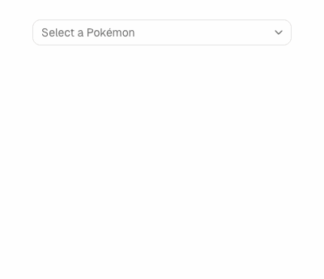

<h1 align="center">Async Combobox</h1>

<h4 align="center">A React combobox with async search and infinite scroll.</h4>

<p align="center">
  <a href="https://react.dev"></a>
  <a href="https://www.typescriptlang.org"></a>
  <a href="https://base-ui.com"></a>
</p>

<p align="center">
  <a href="#key-features">Key Features</a> •
  <a href="#why-i-built-it">Why I Built It</a> •
  <a href="#installation">Installation</a> •
  <a href="#usage">Usage</a> •
  <a href="#built-with">Built With</a>
</p>

<p align="center">
  
</p>

## Key Features

- **Infinite scroll** — load the next page as you scroll through the dropdown, with a configurable threshold.
- **Async search** — connect your own API or data-fetching hook.
- **Single or multiple selection** — choose one value with a clear button, or several with removable chips.
- **Loading and empty states** — separate loading states for searches and additional pages, with skeletons and a field spinner.
- **Custom rendering** — customize options, selected values, chips, loaders, and empty states.
- **Keyboard navigation** — powered by Base UI, with support for disabled and invalid fields.

## Why I Built It

I couldn't find an async combobox with infinite scroll that fit my needs, so I built one.

Async Combobox lets you search remote data and keep loading results inside the dropdown. You supply the items and fetching logic; the component handles selection, loading feedback, and when to request the next page.

## Installation

In a project initialized with [shadcn/ui using Base UI](https://ui.shadcn.com), install both variants:

```bash
npx shadcn@latest add hieu-lai/async-combobox/async-comboboxes
```

Or install just the one you need:

```bash
# Single select
npx shadcn@latest add hieu-lai/async-combobox/async-combobox

# Multi select
npx shadcn@latest add hieu-lai/async-combobox/async-multi-combobox
```

The registry installs the component source, shared files, infinite-scroll hook, and supporting dependencies into your project. Imports below use the default shadcn aliases.

Requires a React version that supports `useEffectEvent`, Tailwind CSS 4, and shadcn theme variables.

## Usage

Pass your data layer's results and pagination state into the component:

```tsx
'use client'

import { useState } from 'react'
import { AsyncCombobox } from '@/components/ui/async-combobox'

type Option = { id: string; name: string }

type Props = {
  items: Option[]
  isLoading: boolean
  isLoadingMore: boolean
  hasMore: boolean
  onSearch: (query: string) => void
  onLoadMore: () => void
}

export function SearchSelect({ onSearch, ...data }: Props) {
  const [value, setValue] = useState<Option>()

  return (
    <>
      <label htmlFor="search-select">Choose an option</label>
      <AsyncCombobox
        {...data}
        id="search-select"
        value={value}
        onValueChange={setValue}
        onQueryChange={onSearch}
        itemToStringLabel={(item) => item.name}
        itemToStringValue={(item) => item.id}
        isItemEqualToValue={(item, selected) => item.id === selected.id}
        scrollThreshold={0.8}
        placeholder="Search options"
        className="w-full max-w-xs"
      />
    </>
  )
}
```

Your data layer should:

- Fetch the first page when the query changes, replace `items`, and reset pagination.
- Append the next page when `onLoadMore` runs, and set `hasMore` to indicate whether another page exists.
- Set `isLoading` for a new search and `isLoadingMore` for additional pages. Both pause infinite scrolling.
- Handle debouncing, caching, errors, and stale responses as needed. The component displays the items you supply without filtering them.

For multiple selection, use `AsyncMultiCombobox` from `@/components/ui/async-multi-combobox`, keep an array as the value, and connect search through `onInputValueChange`.

See the [single-select example](app/single-example.tsx), [multi-select example](app/multi-example.tsx), and [custom rendering example](app/custom-example.tsx) for complete integrations.

## Built With

- [Base UI](https://base-ui.com) — combobox behavior and keyboard interactions.
- [shadcn/ui](https://ui.shadcn.com) — UI components and source distribution.
- [React](https://react.dev), [TypeScript](https://www.typescriptlang.org), and [Tailwind CSS](https://tailwindcss.com).

---

<p align="center">Made by <a href="https://github.com/hieu-lai">Hieu Lai</a></p>
